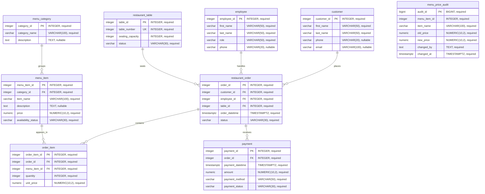

# Restaurant Management System: Updated ERD

Bishnu Bahadur GC and Swastika Poudel  
Atlantis University - CIT 406: Database Design (Fall "A" 2026)  
Professor Anshu Sharma - October 23, 2026

This diagram matches the base tables in `schema.sql` and the audit table added by `logic_layer.sql` or migration 001 in `migrations.sql`. All tables belong to the `restaurant` schema. GitHub renders the Mermaid diagram below when this file is opened in its rendered view.

## Tables, keys, and relationships

## Reading the diagram

- PK identifies a table's primary key. FK identifies a foreign key. UK identifies the unique table-number candidate key.
- Each relationship line shows one parent to zero or many children. Every child foreign key shown is required, so it references exactly one parent.
- An order can contain many menu items through `order_item`. A menu item can appear in many orders. `order_item_id` identifies each line.
- One order can have multiple payment records, allowing partial payments and payment attempts.
- `menu_price_audit` intentionally has no foreign key. Its menu-item ID and name are historical snapshots. The trigger monitors `menu_item.price` and inserts an audit record; that behavior is not a referential relationship.
- Views and functions are documented in `data_dictionary.md` and `logic_layer.sql`; they are not additional stored entity tables.

## Cardinality and referential actions

| Parent | Child and foreign key | Child participation | Parent participation | Delete / update actions |
|---|---|---|---|---|
| customer | restaurant_order.customer_id | Exactly one customer per order | Zero or many orders | RESTRICT / CASCADE |
| employee | restaurant_order.employee_id | Exactly one employee per order | Zero or many orders | RESTRICT / CASCADE |
| restaurant_table | restaurant_order.table_id | Exactly one seating table per order | Zero or many orders over time | RESTRICT / CASCADE |
| menu_category | menu_item.category_id | Exactly one category per menu item | Zero or many menu items | RESTRICT / CASCADE |
| restaurant_order | order_item.order_id | Exactly one order per line | Zero or many lines at the schema level | RESTRICT / CASCADE |
| menu_item | order_item.menu_item_id | Exactly one menu item per line | Zero or many order lines | RESTRICT / CASCADE |
| restaurant_order | payment.order_id | Exactly one order per payment | Zero or many payments | RESTRICT / CASCADE |

## Business-rule notes

A confirmed order should have at least one item. The current foreign keys do not enforce that minimum, so the diagram correctly shows zero or many lines at the schema level. `transactions.sql` demonstrates inserting an order and its items as one unit. A complete confirmation workflow would need additional validation for every write path.

The diagram does not imply that one table can have only one active order at a time; the current schema does not enforce such a restriction. Seating status also does not automatically change when an order changes.

All seven foreign keys use `ON DELETE RESTRICT ON UPDATE CASCADE`. All nine tables have primary keys. `restaurant_table.table_number` also has a UNIQUE constraint. Full default values, CHECK constraints, column purposes, and view outputs appear in `data_dictionary.md`.
